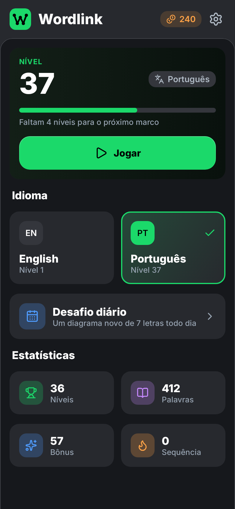
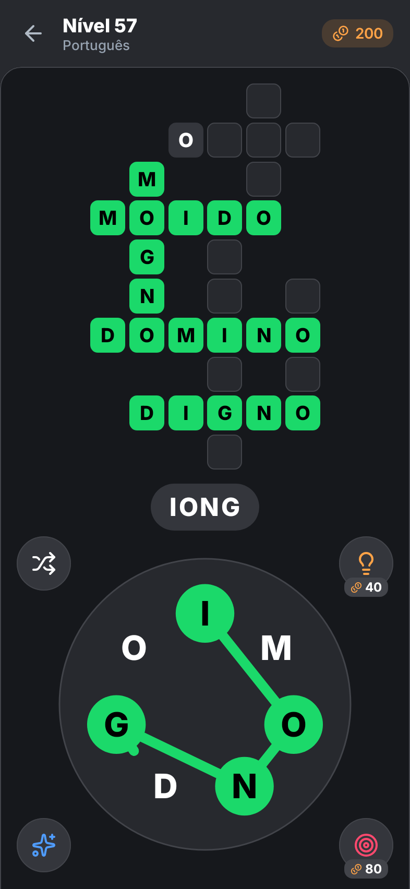
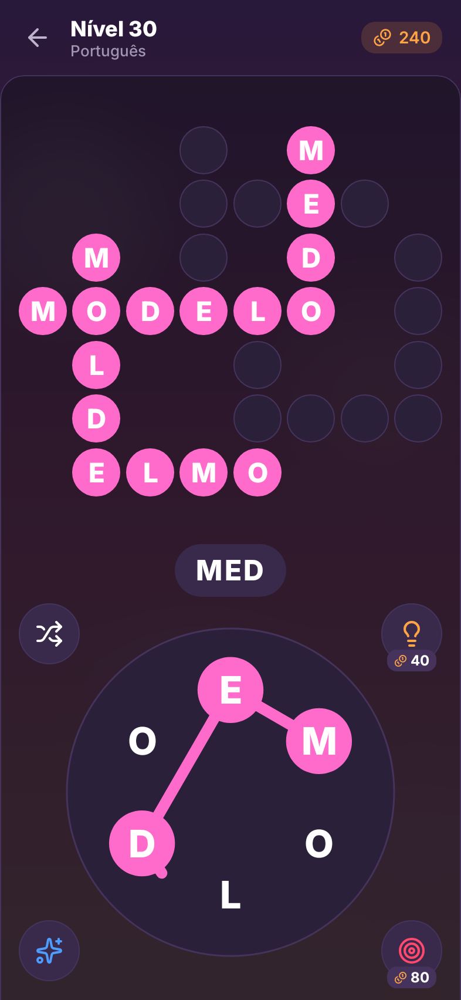
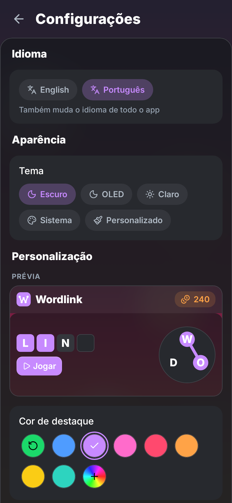
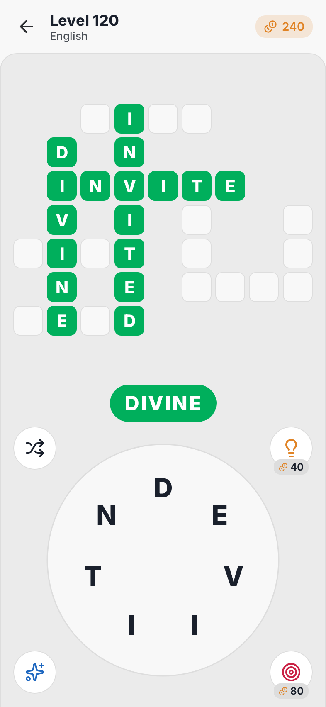

# Wordlink

Jogo de palavras para Android no estilo Wordscapes / Word Cookies: arraste o dedo
pela roda de letras para formar palavras e preencher o diagrama. Feito para ser
**leve e bonito**: APK de ~1,8 MB, sem anúncios, sem internet, sem permissões,
com o visual do **design system do Modrinth App**. Dois modos: **inglês** e
**português (Brasil)**.

<p align="center">
  
  
  
  
  
</p>

> *English:* Wordlink is a lightweight word-connect game for Android (English and
> Brazilian Portuguese) styled after the Modrinth App design system. ~1.8 MB, no
> ads, no network access, no permissions. Build with `./gradlew assembleRelease`.

## Recursos

- **Inglês e português**, com progresso separado por idioma. O idioma escolhido
  vale para o app inteiro (textos, datas, plurais), independente do idioma do
  sistema. Em português a roda usa letras sem acento (como nos jogos do gênero),
  mas a palavra encontrada aparece com a grafia correta: `ACAO` → **AÇÃO**.
  No português valem só palavras de dicionário no **singular** (masculino ou
  feminino) e verbos no **infinitivo**: `CASA` e `FALAR` valem, `CASAS` e
  `FALOU` não. Sem isso cada roda teria dezenas de plurais e conjugações, e o
  pote de bônus enchia sozinho.
- **Níveis infinitos**: cada nível é gerado na hora a partir do número do nível
  (determinístico, ~1–2 ms), com dificuldade crescente: 4 letras no começo,
  7 letras e diagramas maiores depois.
- **Desafio diário** de 7 letras por idioma, com **sequência** de dias.
- **Palavras bônus**: palavras válidas fora do diagrama enchem um pote que vale moedas.
- **Dica** (revela uma letra, 40 moedas), **Alvo** (você escolhe o quadrado,
  80 moedas) e **Embaralhar**. Moedas vêm dos níveis (+10), do desafio diário
  (+50) e do pote de bônus (+20 a cada 10 palavras bônus).
- Temas **Escuro**, **OLED**, **Claro** e **Sistema**, todos com os tokens do Modrinth.
- **Personalização** (Configurações → Personalização), com prévia ao vivo:
  - **Foto de fundo** da galeria (Photo Picker do Android, sem permissões), com
    desfoque, escurecimento e opacidade dos painéis ajustáveis;
  - **Cor de destaque** entre presets ou qualquer cor (matiz, saturação e brilho);
  - **Tema personalizado**: escolha uma cor base e o app deriva todas as
    superfícies, bordas e textos, no modo claro ou escuro conforme a cor;
  - formato dos quadrados (quadrado, arredondado, círculo), tamanho da roda,
    **modo canhoto** e **reduzir animações**.
- Efeitos sonoros (sintetizados, com tom subindo a cada letra) e vibração háptica.
- **90/120/144 Hz**: o app pede o modo de maior taxa de atualização da tela
  (desligável nas configurações), já que muitos aparelhos prendem apps em 60 Hz.
- Layout para retrato e paisagem (tablets), interface em inglês e português.

## Por que é leve

| | |
| --- | --- |
| Interface | Jetpack Compose puro (`foundation`), **sem Material** e sem motor de jogo |
| Roda de letras | Um único `Canvas`; arrastar o dedo só redesenha uma camada, não recompõe nada |
| Dicionários | Palavras de mesmo tamanho concatenadas numa string e busca binária: ~70 mil palavras ocupam poucas centenas de KB de heap |
| Geração de níveis | Algoritmo próprio de palavras cruzadas, ~1–2 ms por nível na JVM |
| Fontes | Inter em instâncias estáticas com subconjunto latino (~50 KB cada, em vez de 880 KB) |
| Sons | 6 efeitos sintetizados por script, ~130 KB no total |
| Foto de fundo | Reduzida na importação e desfocada uma vez (redução + box blur); desenhar é uma única textura, sem custo por quadro |
| Build | R8 + shrink de recursos; APK release de ~1,8 MB |

## Instalar

- **APK pronto**: em cada push o GitHub Actions gera os APKs (aba *Actions* →
  build → artefato `apk`). Ao criar uma tag `v*` (ex.: `v1.0.0`) o APK é anexado
  automaticamente a um *Release*.
- **Compilando**: veja abaixo e instale com
  `adb install app/build/outputs/apk/release/app-release.apk`.

Requer Android 8.0 (API 26) ou mais novo.

### iPhone e navegador (PWA)

A pasta `web/` tem a mesma versão como app web instalável, publicada no GitHub
Pages a cada push no `main`. No iPhone: abra o endereço no Safari, toque em
**Compartilhar → Adicionar à Tela de Início**. Instalado assim ele abre em tela
cheia, funciona offline e fica livre da limpeza do Safari, que apaga os dados de
sites não abertos por 7 dias.

- Usa o **mesmo motor** do Android (módulo `:core`, Kotlin compilado para JS): o
  nível 57 é o mesmo diagrama nas duas plataformas.
- **Backup do progresso**: em Configurações, "Copiar código" gera um texto
  (`WL1-…`) com moedas, níveis e sequência; "Restaurar" em outro aparelho, seja
  Android ou web, continua de onde parou.
- Limitações do iOS: o Safari não tem API de vibração e o progresso fica só no
  aparelho (use o código de backup para levá-lo).

## Compilar

Requisitos: JDK 17+ (testado com 21) e Android SDK com a plataforma 37.2
(o Android Studio ou o Gradle instalam o que faltar).

```bash
./gradlew assembleDebug          # APK de desenvolvimento
./gradlew assembleRelease        # APK otimizado (R8)
./gradlew testDebugUnitTest      # testes do gerador + capturas de tela
./gradlew lintDebug
```

Sem Android Studio, crie um `local.properties` apontando para o SDK
(no Windows, escape o `:`):

```properties
sdk.dir=C\:/Users/voce/AppData/Local/Android/Sdk
```

### Web

Requisitos: Node 22+ e o JDK (para compilar o motor Kotlin para JS).

```bash
cd web
npm ci
npm run core      # compila :core para JS (Gradle)
npm run dev       # servidor de desenvolvimento
npm run build     # web/dist, com service worker para jogar offline
```

Dicionários e sons são copiados de `app/src/main` na hora do build, então
continuam com uma única cópia no repositório.

### Testes e capturas de tela

`testDebugUnitTest` roda:

- `LevelGeneratorTest`: gera 400 níveis por idioma e 120 diários e verifica que
  cada diagrama é válido (sem letras conflitantes, sem palavras encostadas,
  toda sequência de letras é uma resposta, todas as respostas cabem na roda),
  que a geração é determinística e que nenhum nível repete as letras de outro.
- `GameSessionTest`: regras da partida (palavras, bônus, dicas, e palavras
  reveladas só pelos cruzamentos contando como encontradas).
- `CustomizationTest`: paletas derivadas de uma cor, contraste do destaque e
  translucidez com foto de fundo.
- `ScreenshotTest`: renderiza as telas reais com Robolectric e salva PNGs em
  `app/build/screenshots/` (as imagens deste README saem daí); também verifica
  que a interface muda junto com o idioma do jogo e que ligar e desligar o Alvo
  não apaga os quadrados escondidos.

> No Windows, se a pasta do usuário tiver espaço (ex.: `C:\Users\Nome Sobrenome`),
> o Robolectric não consegue carregar o runtime gráfico do `~/.m2`. Aponte para o
> caminho curto (8.3) da pasta do jar:
> `./gradlew testDebugUnitTest -Probolectric.offline=true -Probolectric.dependency.dir=C:\Users\NOMESO~1\.m2\repository\org\robolectric\android-all-instrumented\16-robolectric-13921718-i7`

### Assinatura de release

Sem configuração, o release é assinado com a chave de debug (instala normalmente,
mas não serve para a Play Store). Para usar sua chave, crie `keystore.properties`
na raiz (ignorado pelo git):

```properties
storeFile=release.jks
storePassword=...
keyAlias=...
keyPassword=...
```

No GitHub Actions, cadastre os secrets `KEYSTORE_BASE64` (o `.jks` em base64),
`KEYSTORE_PASSWORD`, `KEY_ALIAS` e `KEY_PASSWORD`.

## Como os níveis são gerados

1. Escolhe-se uma **palavra-base** com o número de letras do nível, entre as
   palavras mais comuns do idioma (embaralhadas em faixas de frequência, então
   os primeiros níveis usam palavras mais familiares). Fica só uma palavra por
   conjunto de letras, para que anagramas (ex.: QUARTO/QUATRO) não virem o
   mesmo nível duas vezes.
2. Todas as palavras comuns que cabem nas letras da base viram candidatas.
3. O montador de palavras cruzadas faz ~48 tentativas aleatórias: a base entra
   primeiro e as demais se encaixam cruzando letras iguais, sem encostar em
   palavras paralelas e dentro de um tamanho máximo. Vence o diagrama com mais
   palavras, mais cruzamentos e menor área.
4. Palavras válidas que não entraram no diagrama valem como **bônus**. Uma
   palavra cujas letras já foram todas reveladas pelos cruzamentos conta como
   encontrada automaticamente.

| Níveis | Letras | Palavras no diagrama | Grade máx. |
| --- | --- | --- | --- |
| 1–6 | 4 | 3–5 | 6×7 |
| 7–20 | 5 | 4–7 | 8×8 |
| 21–50 | 6 | 5–9 | 9×9 |
| 51+ | 7 (a cada 7 níveis, um de 6) | 6–13, crescendo | 10×10 |

Os níveis não são aleatórios: o mesmo número de nível gera o mesmo diagrama
para todo mundo, então o progresso salvo é só o número do nível e as palavras
já encontradas.

## Dicionários

Gerados por `tools/build_dictionaries.py` a partir de fontes fixadas em
revisões específicas (baixadas para `tools/.cache/`):

- **Inglês**: palavras válidas do ENABLE2K e do SCOWL/Hunspell en_US; as
  respostas são as mais frequentes em legendas (FrequencyWords) que também estão
  em minúsculas no Hunspell, o que elimina nomes próprios e siglas.
- **Português**: verbetes do léxico e frequência do
  [fserb/pt-br](https://github.com/fserb/pt-br). Plurais são removidos por regra
  (com exceções como `mais`, `seis`, `ônibus` em `tools/data/not_plural_pt.txt`)
  e formas verbais que o léxico lista como verbete (`estou`, `seja`) por uma
  lista em `tools/data/verb_forms_pt.txt`. As respostas também precisam existir
  no VERO (corretor do LibreOffice). Acentos e cedilha são removidos para a
  roda, guardando a grafia mais frequente para exibição.
- Listas manuais em `tools/data/` removem palavrões (nunca aceitos), nomes,
  estrangeirismos e termos sensíveis (aceitos só como bônus).

## Design

As cores, raios, tipografia e formatos de componentes seguem os tokens do
Modrinth App (`packages/assets/styles/variables.scss` e `packages/ui` em
[modrinth/code](https://github.com/modrinth/code)):

| Token | Escuro | OLED | Claro |
| --- | --- | --- | --- |
| `surface-1` (fundo) | `#16181C` | `#000000` | `#EBEBEB` |
| `surface-3` (cards, moldura) | `#27292E` | `#101013` | `#F8F8F8` |
| `surface-4` (botões) | `#34363C` | `#1B1B20` | `#FFFFFF` |
| `brand` | `#1BD96A` | `#1BD96A` | `#00AF5C` |

Fonte Inter (400–800), ícones Lucide (a mesma base dos ícones do Modrinth),
botões com escala 0,97 ao pressionar, raios de 12–20 dp e a moldura do app
desktop: barra superior em `surface-3` e painel de conteúdo com cantos
arredondados e borda fina. Nenhum código, logo ou marca do Modrinth é usado;
o Wordlink não tem afiliação com o Modrinth.

## Estrutura

```
core/src/commonMain/   Motor compartilhado (Kotlin Multiplatform: JVM para o Android, JS para a web)
├── game/        Dicionário, gerador de palavras cruzadas e níveis
└── backup/      Código de backup do progresso (WL1-…)
web/src/         App web: estado, telas, roda de letras, temas e service worker (TypeScript)
app/src/main/java/io/github/dmrangel/wordlink/
├── game/        Estado da partida
├── data/        Persistência (SharedPreferences)
├── ui/          ViewModel, efeitos (som/vibração) e telas
│   ├── theme/       Tokens do design system
│   ├── components/  Botões, cards, chips, toggles, moldura do app
│   ├── game/        Roda de letras, diagrama, sobreposições
│   ├── home/ settings/
│   └── icons/       Ícones Lucide gerados
└── MainActivity.kt  Edge-to-edge e taxa de atualização alta
tools/           Scripts que geram dicionários, fontes, sons e ícones
docs/            Capturas de tela
```

### Regenerar os recursos

```bash
python tools/build_dictionaries.py   # app/src/main/assets/dict/{en,pt}.txt
pip install fonttools brotli && python tools/make_fonts.py
python tools/make_fonts.py --web     # web/public/fonts/inter-latin.woff2
python tools/make_sounds.py          # app/src/main/res/raw/*.wav
python tools/gen_icons.py            # ui/icons/Lucide.kt e web/src/icons.ts
python tools/gen_web_icons.py        # ícones do PWA em web/public/icons/
```

## Licença

Código sob [MIT](LICENSE). Os dicionários, a fonte e os ícones têm licenças
próprias (CC BY-SA 4.0, MPL 2.0, OFL 1.1, ISC); veja
[THIRD_PARTY_NOTICES.md](THIRD_PARTY_NOTICES.md).
